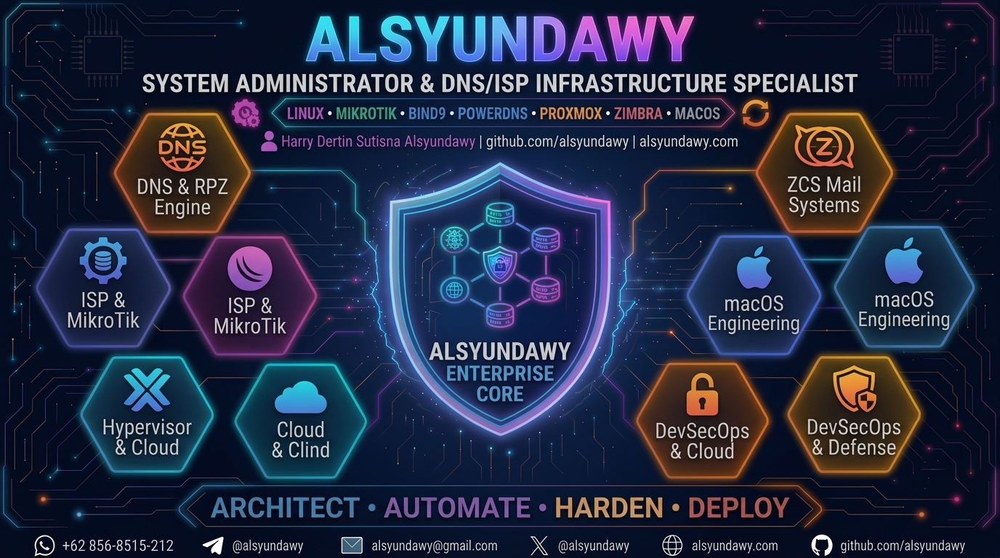

<!-- markdownlint-disable MD033 MD041 MD013 -->

  

<h2 align="center">System Administrator &amp; DNS/ISP Infrastructure Specialist 🚀</h2>

  <i>System Administrator Magang • Hypervisor, Mail &amp; DNS Infrastructure Specialist • Jakarta, ID</i>

  <b>English</b> • <a href="./README-ID.md">Bahasa Indonesia</a>

  
  
  
  
  
  
  
  
  

---

### 📖 About Me

<table border="0" width="100%">
  <tr>
    <td width="58%" valign="top">
      

        Internet addict, Windows, macOS, FreeBSD, and Linux lover. I am a <b>System Administrator &amp; System Engineer</b> (humorously styled as <i>System Administrator Magang</i>) with <b>15+ years of experience</b> specializing in ISP operations, DNS filtering architectures, mail server deployments, hypervisors, and Apple Mac technical support.
      

      

        📍 Based in <b>DKI Jakarta, Indonesia</b> • Building robust, scalable, and resilient network infrastructures.
      

      <blockquote><i>"ɪɴᴛᴇʀɴᴇᴛ ᴀᴅᴅɪᴄᴛ, ᴡɪɴᴅᴏᴡs, ᴍᴀᴄ, ꜰʀᴇᴇʙsᴅ &amp; ʟɪɴᴜx ʟᴏᴠᴇʀ — ɪ ᴀᴍ ɴᴏᴛ ᴀ ɢᴏᴏᴅ ᴍᴀɴ, ʙᴜᴛ ᴀ ᴍᴀɴ ɪɴ ᴀ ɢᴏᴏᴅ ᴅᴀʏ."</i></blockquote>
    </td>
    <td width="42%" valign="top">
      <ul>
        <li>🛠️ <b>Current Role:</b> OpisBoy | Teknisi Mac &amp; Server Keliling | DNS &amp; ISP Infrastructure Specialist</li>
        <li>🌐 <b>Portfolio &amp; Lab:</b> <a href="https://alsyundawy.com"><b>alsyundawy.com ↗</b></a></li>
        <li>💬 <b>Ask me about:</b> DNS Filtering, BIND9/PowerDNS, MikroTik RouterOS, Zimbra Mail Server, Proxmox/VMware, and macOS deployments.</li>
        <li>✉️ <b>Email:</b> <a href="mailto:alsyundawy@gmail.com">alsyundawy@gmail.com</a></li>
      </ul>
    </td>
  </tr>
</table>

  
💖 <b>QRIS Support / Dukungan QRIS</b> (Click to view QRIS payment barcode)

  

    If you find my projects and guides helpful, consider supporting ongoing development via QRIS. Thank you for your support! 🙏
      
    
  

---

### 🌐 Live Tools & Services

I host and maintain several public tools and services to assist network engineers and administrators:

| Service / Tool | Description | Status & Link |
| :--- | :--- | :---: |
| 🔍 **Looking Glass** | Enterprise-grade network diagnostic tools (Ping, Trace, MTR, BGP) | 🟢 [lg.alsyundawy.com ↗](https://lg.alsyundawy.com) |
| ⚡ **Looking Glass v2.5** | Advanced multi-engine diagnostic interface with BIRD / FRR integration | 🟢 [lgv2.php ↗](https://lg.alsyundawy.com/lgv2.php) |
| 🌐 **Looking Glass (v2.0)** | Classic lightweight diagnostic interface | 🟢 [lg.php ↗](https://lg.alsyundawy.com/lg.php) |
| 💻 **Looking Glass (v2.1)** | Alternative fast diagnostic portal | 🟢 [lgv1.php ↗](https://lg.alsyundawy.com/lgv1.php) |
| 🐙 **Looking Glass (GitHub)** | Open-source diagnostic release mirror | 🟢 [lg-github.php ↗](https://lg.alsyundawy.com/lg-github.php) |
| 📡 **MultiPing** | Multi-location ping latency & jitter analysis | 🟢 [multiping.php ↗](https://lg.alsyundawy.com/multiping.php) |
| 🛡️ **Open DNS Scanner** | Public DNS Open Resolver auditor, DDoS amplification analysis & DNSSEC validator | 🟢 [resolver.php ↗](https://lg.alsyundawy.com/resolver.php) |
| 🚀 **SpeedTest** | High-performance HTML5 bandwidth & latency benchmark | 🟢 [speedtest.alsyundawy.com ↗](https://speedtest.alsyundawy.com/) |
| 🛡️ **RBL Checker** | Real-time multi-DNSBL email blacklist checker | 🟢 [rbl.alsyundawy.com ↗](https://rbl.alsyundawy.com/) |
| 🚦 **TrustPositif Check** | Real-time Komdigi TrustPositif domain blacklist query | 🟢 [trustcheck.alsyundawy.com ↗](https://trustcheck.alsyundawy.com/) |
| 🗺️ **DNS Checker** | Global multi-server DNS propagation test | 🟢 [dnschecker.alsyundawy.com ↗](https://dnschecker.alsyundawy.com/) |
| 📦 **Custom Repository** | Personal repo hosting configuration files & packages | 🟢 [repo.alsyundawy.com ↗](https://repo.alsyundawy.com/) |
| 🧮 **Visual Subnet Calculator** | Visual IPv4 & IPv6 Subnet Planner, CIDR splitting/joining, cloud IP reservation (AWS/Azure/GCP/OCI) & zero server-side storage | 🟢 [alsyundawy.com/subnet ↗](https://alsyundawy.com/subnet/) *(Mirror: [GitHub Pages ↗](https://alsyundawy.github.io/visualsubnetcalc/))* |

---

### 📚 Technical Guides & Tutorials

Curated enterprise tutorials, server architectures, and deployment guides from [alsyundawy.com](https://alsyundawy.com):

| Category | Tutorial / Guide | Description | Guide Link |
| :--- | :--- | :--- | :---: |
| ✉️ **Mail Systems** | **Build Zimbra FOSS** | Complete guide to building Zimbra Collaboration 10.1.x FOSS from source (zm-build) for Ubuntu 24.04 & Rocky 9 | [View Guide ↗](https://alsyundawy.com/Build-Zimbra-FOSS.html) |
| ✉️ **Mail Systems** | **Install Zimbra FOSS** | Installation of Zimbra Collaboration 10.1.x FOSS on Ubuntu Server 24.04 LTS & Rocky Linux 9 / AlmaLinux 9 | [View Guide ↗](https://alsyundawy.com/Install-Zimbra-FOSS.html) |
| 🔒 **DNS & RPZ** | **TrustPositif To RPZ Binary** | BIND9 DNS filtering implementation with Komdigi RI TrustPositif RPZ, Whitelist & Google SafeSearch | [View Guide ↗](https://alsyundawy.com/TrustPositif-RPZ-Install.html) |
| 🔒 **DNS & RPZ** | **PowerDNS-Admin (Debian 13)** | Master-Slave PowerDNS Authoritative setup with PowerAdmin for ISP DNS redundancy | [View Guide ↗](https://alsyundawy.com/PowerDNS-Admin-Debian.html) |
| 🔒 **DNS & RPZ** | **PowerDNS-Admin (Ubuntu 22.04)** | Automation & deployment of PowerDNS Authoritative MariaDB with PowerDNS-Admin Flask Web UI | [View Guide ↗](https://alsyundawy.com/PowerDNS-Admin-Ubuntu.html) |
| 🔒 **DNS & RPZ** | **PHP PowerAdmin** | PowerDNS Authoritative with Poweradmin UI for zone management, DNSSEC, and REST API | [View Guide ↗](https://alsyundawy.com/PowerAdmin.html) |
| ☁️ **Hypervisors** | **Proxmox VE 9** | Installation and configuration guide for Proxmox VE 9 on Debian/Ubuntu: cluster, storage, VM & LXC | [View Guide ↗](https://alsyundawy.com/Proxmox-VE-9.html) |
| ☁️ **Hypervisors** | **vSphere Unsupported HW** | Installation and upgrade of VMware vSphere / ESXi on officially unsupported server hardware | [View Guide ↗](https://alsyundawy.com/vSphere.html) |
| 📊 **Monitoring** | **Prometheus & Grafana** | Complete infrastructure monitoring with Prometheus, Node Exporter, Grafana & Zabbix 7.0 LTS | [View Guide ↗](https://alsyundawy.com/Prometheus-Grafana-Debian.html) |
| 📊 **Monitoring** | **Cacti Monitoring Stack** | Installation of Cacti network graphing tool on Debian with Apache/Nginx on root domain | [View Guide ↗](https://alsyundawy.com/Cacti.html) |
| 🛜 **Network & Tools** | **HyperGlass** | Modern Python BGP Looking Glass with BIRD, FRR, OpenBGPD, Nginx reverse proxy & Redis integration | [View Guide ↗](https://alsyundawy.com/HyperGlass.html) |
| 🛜 **Network & Tools** | **PHP-LookingGlass** | Single-file PHP network diagnostic tool for ping, traceroute, BGP route lookup & DNS resolution | [View Guide ↗](https://alsyundawy.com/PHP-LookingGlass.html) |
| 🛜 **Network & Tools** | **phpIPAM** | phpIPAM IP Address Management for IP allocation, VLAN, subnetting, and automated network scanning | [View Guide ↗](https://alsyundawy.com/phpIPAM.html) |
| 🛡️ **VPN & Security** | **OpenVPN Road Warrior** | Deployment of OpenVPN Road Warrior dual-stack IPv4/IPv6 with Unbound DNS resolver & security hardening | [View Guide ↗](https://alsyundawy.com/OpenVPN-Install.html) |
| 🚀 **ISP Services** | **Ookla Speedtest Server** | Production Ookla Speedtest Server deployment with dual-stack IPv4 & IPv6 configuration and systemd | [View Guide ↗](https://alsyundawy.com/Ookla-Speedtest.html) |
| 📡 **PTT & Telephony** | **WalkieFleet Server** | Comprehensive guide to installing WalkieFleet Push-to-Talk (PTT) server on Linux Debian & Ubuntu | [View Guide ↗](https://alsyundawy.com/WalkieFleet.html) |
| 🧪 **Network Lab** | **Install & Deploy PNETLab v8** | Comprehensive guide to install, upgrade, and deploy PNETLab v8 Unofficial on Ubuntu 26.04: dedicated mirror, held packages & UFW | [View Guide ↗](https://alsyundawy.com/PNETLab-v8.html) |
| 🧪 **Network Lab** | **PNETLab v4 · v5 · v6 Klasik** | Comprehensive guide to install, stepwise upgrade, and deploy classic PNETLab v4/v5/v6: Bionic & Focal with rev3 script & LabHub | [View Guide ↗](https://alsyundawy.com/PNETLab-v4.html) |

---

### 🛠️ Technical Expertise

#### 🛜 ISP Hardware & System Infrastructure

  
  
  
  
  

- **Management:** Server hardware installation, MikroTik RouterOS deployment, bandwidth optimization, BGP routing, and VPN networking (WireGuard, OpenVPN).
- **Monitoring:** Smokeping, Uptime Kuma, Cacti, PRTG, Nagios, Zabbix, MRTG, Grafana, and Netdata with sub-minute intervals.

#### 🔒 DNS Filtering & Security (TrustPositif)

  
  
  
  

- **Engines:** PowerDNS, BIND9, Unbound, and Knot DNS.
- **RPZ Specialist:** Expert implementation of Response Policy Zone (RPZ) DNS firewalls and TrustPositif database (Kementerian Kominfo RI) conversion.

#### ☁️ Hypervisors & Virtualization

  
  
  
  

- **Platforms:** Proxmox VE, VMware ESXi/vSphere/vCenter, KVM, Hyper-V, QEMU.
- **Orchestration:** High-Availability (HA) clustering, live VM migrations, resource tuning, and VM backup strategies.

#### ✉️ Mail, SMTP Systems & Hosting Services

  
  
  
  

- **Platforms:** Zimbra Collaboration Suite, Proxmox Mail Gateway, WHM/cPanel, Postfix, Dovecot.
- **Securing Mail:** DKIM, SPF, DMARC alignment, Rspamd, SpamAssassin, ClamAV, and custom anti-spam filters.

#### 🍎 Apple Mac Services & Deployment

  
  

- **Expertise:** Certified macOS installation, diagnostic operations, hardware upgrades, and enterprise integration (Apple Silicon M1/M2/M3/M4 optimization).

#### 🛡️ DevSecOps & Security Hardening

  
  
  
  

- **Hardening:** Zero-CDN air-gapped runtimes, strict CSP nonce enforcement, SHA-384 Subresource Integrity, automated webshell quarantine, and malware forensic remediation.

---

### 🚀 Curated Repository Portfolio (680+ Public Repositories)

> 📊 **Portfolio Matrix:** **66** Original Source Repositories • **69** Actively Contributed Forks • **99+** Curated Upstream Forks • **0** Archived (Strictly Filtered)

---

#### 🌟 Priority 1: Original Core Projects (Murni Buatan Sendiri)

*High-impact production systems, authoritative DNS control planes, cross-platform utilities, and mail automation engines engineered from scratch by Harry DS Alsyundawy.*

##### 🛡️ DNS Infrastructure, RPZ & Threat Intelligence

- 📦 **[PowerDNS-Admin-PHP](https://github.com/alsyundawy/PowerDNS-Admin-PHP)**  
  *Enterprise Authoritative PowerDNS Web Control Plane in Native PHP & PDO — Zero external runtime frameworks, <1ms sub-millisecond bootstrap, 100% offline air-gapped Zero-CDN architecture, RFC 6238 TOTP 2FA, multi-server node clustering, APCu caching, and direct PowerDNS HTTP API v1 integration.* 
  `PHP` `PowerDNS` `DNS` `Control-Plane` `Security` `REST-API`
- 📦 **[PHP-PDNSManager](https://github.com/alsyundawy/PHP-PDNSManager)**  
  *Enterprise DNS Management Web GUI & REST API Gateway for PowerDNS Authoritative Server — PHP 8.1+, PSR-compliant architecture, RBAC, and high-performance zone automation.* 
  `PHP` `PowerDNS` `DNS` `REST-API` `Enterprise`
- 📦 **[PHP-BindManager](https://github.com/alsyundawy/PHP-BindManager)**  
  *Enterprise-grade Web GUI for BIND9 DNS Server Management — PHP 8.4+, Bootstrap 5, Tailwind CSS, SQLite3, RBAC, DNSSEC, REST API.* 
  `PHP` `BIND9` `DNS` `DNSSEC` `REST-API`
- 📦 **[TrustPositif-To-RPZ-Binary](https://github.com/alsyundawy/TrustPositif-To-RPZ-Binary)**  
  *Converts Kominfo TrustPositif domains into DNS RPZ format. Features whitelist & Google SafeSearch helper.* 
  `Go` `Shell` `DNS` `RPZ` `Blocklist`
- 📦 **[TrustPositif](https://github.com/alsyundawy/TrustPositif)**  
  *Comprehensive raw TrustPositif domain database with daily automated updates.* 
  `Database` `Kominfo` `Blocklist`
- 📦 **[TrustPositif-Validator](https://github.com/alsyundawy/TrustPositif-Validator)**  
  *High-performance domain validation, IDN Punycode normalization & blocklist aggregation pipeline for TrustPositif/Komdigi. ShellCheck Certified.* 
  `Shell` `Validator` `RFC-Compliant` `Punycode`
- 📦 **[sunat-trustpositif](https://github.com/alsyundawy/sunat-trustpositif)**  
  *Shell script that validates domain lists against official IANA TLDs and cleanses database records.* 
  `Shell` `TLD` `Data-Cleansing`
- 📦 **[StevenBlack-Host-RPZ](https://github.com/alsyundawy/StevenBlack-Host-RPZ)**  
  *Converts the StevenBlack host lists to DNS RPZ format.* 
  `DNS` `RPZ` `StevenBlack`
- 📦 **[PowerDNS-Zone-Backups](https://github.com/alsyundawy/PowerDNS-Zone-Backups)**  
  *Automated PowerDNS zone backup solution with incremental backups and retention rotation.* 
  `PowerDNS` `Backup` `Database`
- 📦 **[bind-acl-indonesia-openixp](https://github.com/alsyundawy/bind-acl-indonesia-openixp)**  
  *Automatically generates Indonesian IP ACL files for BIND9 DNS using Nice.rsc and APNIC data.* 
  `BIND9` `ACL` `OpenIXP` `APNIC`
- 📦 **[IP2RPZ](https://github.com/alsyundawy/IP2RPZ)**  
  *High-speed C utility to convert IP threat feeds into DNS RPZ format.* 
  `C` `DNS` `RPZ` `Firewall`
- 📦 **[dnstrust-apjii](https://github.com/alsyundawy/dnstrust-apjii)**  
  *DNS-Trust Database BIND9 || DNS Bersih TrustPositif APJII.* 
  `DNS` `BIND9` `APJII` `TrustPositif`

##### 🖥️ Diagnostics, Telemetry, Subnetting & IPAM

- 📦 **[php-looking-glass](https://github.com/alsyundawy/php-looking-glass)**  
  *A professional, secure, single-file PHP Looking Glass for network diagnostics (Ping, Traceroute, MTR, WHOIS, DNS Lookup, Iperf3).* 
  `PHP` `Network` `Looking-Glass` `MTR`
- 📦 **[SubNetCalc-Electron](https://github.com/alsyundawy/SubNetCalc-Electron)**  
  *High-Precision, Low-Footprint IPv4 & IPv6 Subnet Calculator with 14 Multi-Themes for macOS & Cross-Platform desktop. Powered by Electron 44, React 19, and TypeScript with real-time RFC classification and binary bit visualization.* 
  `TypeScript` `Electron` `React` `Networking` `Subnetting` `Cross-Platform`
- 📦 **[SubnetCalc-Windows](https://github.com/alsyundawy/SubnetCalc-Windows)**  
  *High-Performance, Native C11 & Win32 IPv4 & IPv6 Subnet Calculator for Windows (x86/x64) with instant memory rendering and themes.* 
  `C` `Win32` `Subnetting` `Networking` `Windows`
- 📦 **[dnsperftest](https://github.com/alsyundawy/dnsperftest)**  
  *Comprehensive DNS benchmark, latency evaluation, and public resolver performance tester.* 
  `Shell` `DNS` `Benchmark` `Latency`
- 📦 **[File-Directory-Browser](https://github.com/alsyundawy/File-Directory-Browser)**  
  *Lightweight, security-hardened single-file PHP directory browser featuring CSRF protection, output sanitization, and SHA-256 hash checks.* 
  `PHP` `Security` `File-Manager`
- 📦 **[bailu-kilo-agent](https://github.com/alsyundawy/bailu-kilo-agent)**  
  *Agentic coding sidebar for BAILU AI — Kilo-style panel, model picker, Auto, thinking mode, and API token integration for VS Code & Code-OSS forks.* 
  `TypeScript` `VSCode` `AI-Agent` `Agentic-Coding` `Extension`

##### ✉️ Mail Systems & Zimbra Collaboration Suite

- 📦 **[eradicate-zimbra-malware](https://github.com/alsyundawy/eradicate-zimbra-malware)**  
  *Enterprise Forensic Incident Response, Anti-Ransomware, Polyglot Webshell Quarantine & Zimbra Permission Healing Suite.* 
  `Shell` `Security` `Forensics` `Zimbra` `Incident-Response`
- 📦 **[Zimbra-Link-Installer](https://github.com/alsyundawy/Zimbra-Link-Installer)**  
  *The Complete Zimbra Collaboration Archive & Installer Suite. Direct binary downloads, official & community builds, cryptographic checksums, and automated CLI installer (ZCS 4.5.x – 10.1.x).* 
  `Shell` `HTML` `Zimbra` `Installer` `Mail-Server`
- 📦 **[Z2C (Zimbra to Carbonio Migration)](https://github.com/alsyundawy/Z2C)**  
  *Zimbra to Carbonio Migration tool. A set of scripts to export domains, accounts, aliases, and mailboxes, supporting parallel migration.* 
  `Shell` `Zimbra` `Carbonio` `Migration`
- 📦 **[cmbackup](https://github.com/alsyundawy/cmbackup)**  
  *Next-generation hot backup, restore, and migration engine from Zimbra to Carbonio.* 
  `Shell` `Carbonio` `Zimbra` `Backup`
- 📦 **[uninstall-zimbra](https://github.com/alsyundawy/uninstall-zimbra)**  
  *Complete Bash utility to clean-uninstall Zimbra instances from Linux.* 
  `Zimbra` `Uninstaller` `Bash`
- 📦 **[Zimbra-Clean-Spam](https://github.com/alsyundawy/Zimbra-Clean-Spam)**  
  *Scan and purge spam email queues caused by compromised accounts.* 
  `Zimbra` `Mail-Server` `Spam-Cleaner`

##### ☁️ Desktop Apps, macOS, Hypervisors & System Engineering

- 📦 **[Microsoft-Office-For-MacOS](https://github.com/alsyundawy/Microsoft-Office-For-MacOS)**  
  *Complete Mac installer bundle for Microsoft Office (Intel/Apple Silicon) with LTSC volume serializer.* 
  `Shell` `macOS` `Installer` `Office` `Apple-Silicon`
- 📦 **[SparkNotePad](https://github.com/alsyundawy/SparkNotePad)**  
  *Lightweight, blazing-fast native Scintilla & Qt text and source code editor for Linux and macOS. Engineered with ISO C++20, Qt 6, and Scintilla 5.6.7 / Lexilla 5.5.4 core for minimal memory footprint (<35MB), instant rendering, AES-256 encryption, and 75 developer themes.* 
  `C++20` `Qt6` `Scintilla` `macOS` `Linux` `FreeBSD` `Code-Editor`
- 📦 **[XiaomiADBFastbootTools-Win32](https://github.com/alsyundawy/XiaomiADBFastbootTools-Win32)**  
  *ADB and fastboot tools optimized for Xiaomi devices on Windows.* 
  `C#` `Windows` `ADB` `Fastboot` `Xiaomi`
- 📦 **[PnetLab-v8](https://github.com/alsyundawy/PnetLab-v8)**  
  *Enterprise network virtualization & emulation platform on Ubuntu 26.04 LTS (Resolute). Turn-key OVA, ISO, and Proxmox VE 8+ deployment guide.* 
  `Ubuntu` `Proxmox` `Virtualization` `Network-Emulation` `PNETLab` `KVM`
- 📦 **[NotepadNext-MacOS](https://github.com/alsyundawy/NotepadNext-MacOS)**  
  *Native macOS reimplementation of Notepad++ built with Qt 6. Fast, lightweight, and modern.* 
  `C++` `macOS` `NotepadNext` `Editor` `Qt6`
- 📦 **[openssl-1.0.2](https://github.com/alsyundawy/openssl-1.0.2)**  
  *Production-grade security hardened fork and backported CVE mitigations for legacy OpenSSL 1.0.2 (up to 1.0.2zr).* 
  `C` `OpenSSL` `Security` `Hardening` `CVE-Mitigation` `Backport`
- 📦 **[Disable-MacOS-Updates](https://github.com/alsyundawy/Disable-MacOS-Updates)**  
  *Reversible Bash scripts to disable automatic software updates on macOS (Monterey to Golden Gate).* 
  `macOS` `Bash` `Apple-Silicon` `DAW` `Sysadmin`
- 📦 **[mikrotik-blacklist](https://github.com/alsyundawy/mikrotik-blacklist)**  
  *RouterOS automated threat intelligence blacklist updates and firewall address-lists.* 
  `RouterOS` `Blacklist` `Security`

---

#### 🛠️ Priority 2: Actively Contributed & Patched Forks (Fork dengan Kontribusi Nyata)

*Upstream open-source repositories where Harry DS Alsyundawy authored direct commits, security hardening, or maintained mission-critical forks.*

- 📦 **[PowerDNS-Admin](https://github.com/alsyundawy/PowerDNS-Admin)**  `[136 Commits]` 
  *Enterprise web control panel for PowerDNS Authoritative Server with custom MariaDB pooling, LDAP optimizations, and UI enhancements.* 
  `Python` `PowerDNS` `DNS` `Web-GUI` `Enterprise`
- 📦 **[shc](https://github.com/alsyundawy/shc)**  `[54 Commits]` 
  *Generic Shell Script Compiler with Enhanced Security & Auditing. Encrypts and compiles shell scripts into stripped binary executables.* 
  `C` `Shell` `Security` `Auditing` `Hardening`
- 📦 **[visualsubnetcalc](https://github.com/alsyundawy/visualsubnetcalc)**  `[49 Commits]` 
  *Visual Subnet Calculator — Modernized & Hardened Edition. Visual, interactive IPv4/IPv6 CIDR subnet planner with real-time bit splitting and zero server-side storage.* 
  `TypeScript` `Networking` `Subnetting` `IPv4` `CIDR`
- 📦 **[zmbackup](https://github.com/alsyundawy/zmbackup)**  `[47 Commits]` 
  *Enterprise Multi-Threaded Hot Backup, Zero-Timeout Restore, Cross-OS Migration Engine & Security Hardening for Zimbra Collaboration Suite & Carbonio.* 
  `Shell` `Zimbra` `Backup` `Disaster-Recovery` `Migration`
- 📦 **[pear-desktop-mac](https://github.com/alsyundawy/pear-desktop-mac)**  `[44 Commits]` 
  *High-performance, privacy-hardened macOS desktop client for YouTube Music with built-in ad blocker (27+ vendor filters), SponsorBlock, and synced lyrics.* 
  `macOS` `Apple-Silicon` `YouTube-Music` `Electron` `TypeScript`
- 📦 **[SmartDNS](https://github.com/alsyundawy/SmartDNS)**  `[43 Commits]` 
  *Automated DNS resolver platform for ISP & enterprise networks with multi-upstream routing and latency-based failover.* 
  `HTML` `JavaScript` `DNS` `Resolver` `Routing`
- 📦 **[SubnetCalc-MacOS](https://github.com/alsyundawy/SubnetCalc-MacOS)**  `[32 Commits]` 
  *High-Performance, Native Swift & Cocoa IPv4 & IPv6 Subnet Calculator for macOS (Universal 2: Apple Silicon M1-M4 & Intel x64) with 25 developer theme suites.* 
  `Swift` `macOS` `Apple-Silicon` `AppKit` `Cocoa` `Subnetting` `IPAM`
- 📦 **[ufw-ipset-blocklist-autoupdate](https://github.com/alsyundawy/ufw-ipset-blocklist-autoupdate)**  `[27 Commits]` 
  *Automatically updates IP blocking lists via ipset and UFW firewalls with threat intelligence feeds.* 
  `Shell` `UFW` `Ipset` `Security` `Firewall`
- 📦 **[OpenVPN-Install](https://github.com/alsyundawy/OpenVPN-Install)**  `[24 Commits]` 
  *OpenVPN road warrior installer for Debian, Ubuntu, and CentOS with dual-stack IPv4/IPv6 and Unbound DNS integration.* 
  `Shell` `OpenVPN` `VPN` `Security` `Networking`
- 📦 **[cyberpanel](https://github.com/alsyundawy/cyberpanel)**  `[21 Commits]` 
  *Hosting control panel for OpenLiteSpeed with custom security patches and environment optimizations.* 
  `JavaScript` `Python` `Hosting` `LiteSpeed` `Control-Panel`
- 📦 **[esxi-unlocker-v4](https://github.com/alsyundawy/esxi-unlocker-v4)**  `[11 Commits]` 
  *macOS Unlocker V4 for VMware ESXi. Enables Apple macOS guest support on VMware ESXi hypervisors with maintained shell/Python patching workflow.* 
  `Python` `VMware` `ESXi` `macOS` `Hypervisor`
- 📦 **[Zimbra2Zimbra-Migration-Tool](https://github.com/alsyundawy/Zimbra2Zimbra-Migration-Tool)**  `[11 Commits]` 
  *Z2Z — Zimbra to Zimbra Migration Suite. Enterprise zero-timeout, cross-version, and zero-data-loss migration engine for ZCS 7.x – 10.1.x.* 
  `Shell` `Zimbra` `Migration` `Backup` `Mail-Server`
- 📦 **[Windows10Debloater](https://github.com/alsyundawy/Windows10Debloater)**  `[6 Commits]` 
  *PowerShell script to remove Windows 10/11 bloatware, disable telemetry, and stop unwanted background tasks.* 
  `PowerShell` `Windows` `Debloat` `System-Tuning`
- 📦 **[OpenSID](https://github.com/alsyundawy/OpenSID)**  `[5 Commits]` 
  *Sistem Informasi Desa (SID) open-source with PHP 8+ tuning and server security enhancements.* 
  `PHP` `OpenSID` `Government` `Indonesia`
- 📦 **[Linux-System-Management-Scripts-Tricks](https://github.com/alsyundawy/Linux-System-Management-Scripts-Tricks)**  `[4 Commits]` 
  *Linux System Administrator & Engineer automation scripts, monitoring snippets, and certification tricks.* 
  `Shell` `Linux` `Sysadmin` `DevOps`
- 📦 **[wireguard-install](https://github.com/alsyundawy/wireguard-install)**  `[2 Commits]` 
  *WireGuard road warrior installer for Ubuntu, Debian, CentOS, and Fedora with QR-code profile generator.* 
  `Shell` `WireGuard` `VPN` `Security`
- 📦 **[AutoInstallGenieACS](https://github.com/alsyundawy/AutoInstallGenieACS)**  `[1 Commit]` 
  *Automated installation and service provisioning script for GenieACS TR-069 server on Debian/Ubuntu.* 
  `Shell` `GenieACS` `TR-069` `ISP`
- 📦 **[dnsdist-one-click](https://github.com/alsyundawy/dnsdist-one-click)**  `[1 Commit]` 
  *One-click installer for DNSDist load balancer with automated Komdigi TrustPositif filtering rules.* 
  `Shell` `DNSDist` `DNS` `TrustPositif` `Load-Balancer`
- 📦 **[SlimBrave-Neo](https://github.com/alsyundawy/SlimBrave-Neo)**  `[1 Commit]` 
  *Debloat and harden Brave Browser on Linux and macOS for privacy and performance.* 
  `Python` `Brave` `Privacy` `Debloat`

---

#### 📚 Priority 3: Curated Upstream Forks & Reference Mirrors (Non-Archived)

*Carefully maintained upstream mirrors, network security toolkits, and curated development resources. Strictly excludes all archived repositories.*

<b>📂 Expand Complete Directory of 99+ Active Starred Upstream Forks & Mirrors</b> (Click to view table)

| Repository / Mirror | Stars | Language | Focus & Upstream Reference |
| :--- | :---: | :---: | :--- |
| [**dns-blocklists**](https://github.com/alsyundawy/dns-blocklists) | ★ 10 | `Text` | DNS-Blocklists: For a better internet - keep the internet clean! |
| [**Sefinek-Blocklist-Collection**](https://github.com/alsyundawy/Sefinek-Blocklist-Collection) | ★ 8 | `JavaScript` | 🍒 A comprehensive repository of block lists for Pi-hole and AdGuard, featuring ove... |
| [**Microsoft-Activation-Scripts**](https://github.com/alsyundawy/Microsoft-Activation-Scripts) | ★ 6 | `Batchfile` | A collection of scripts for activating Microsoft products using HWID / KMS38 / Onl... |
| [**skipmdm-bypass**](https://github.com/alsyundawy/skipmdm-bypass) | ★ 5 | `Shell` | AUTOBYPASS MDM Macbook Monterey, Ventura & Sonoma |
| [**IP-Block-Lists**](https://github.com/alsyundawy/IP-Block-Lists) | ★ 4 | `Misc` | IP block lists for: Malware, Bots, Hackers, Sniffers, etc.. |
| [**nginx-ultimate-bad-bot-blocker**](https://github.com/alsyundawy/nginx-ultimate-bad-bot-blocker) | ★ 4 | `Shell` | Nginx Block Bad Bots, Spam Referrer Blocker, Vulnerability Scanners, User-Agents,... |
| [**SecLists**](https://github.com/alsyundawy/SecLists) | ★ 4 | `PHP` | SecLists is the security tester's companion. It's a collection of multiple types o... |
| [**poweradmin**](https://github.com/alsyundawy/poweradmin) | ★ 3 | `PHP` | A web-based control panel for PowerDNS |
| [**Zorin-OS-Pro**](https://github.com/alsyundawy/Zorin-OS-Pro) | ★ 3 | `Shell` | This script turns your Zorin OS CORE into Zorin OS PRO |
| [**Apple-Silicon-Guide**](https://github.com/alsyundawy/Apple-Silicon-Guide) | ★ 3 | `Swift` | Apple Silicon Guide. Learn all about the A16 Bionic, M1, M1 Pro, M1 Max, M1 Ultra,... |
| [**nVidia-modded-Inf**](https://github.com/alsyundawy/nVidia-modded-Inf) | ★ 3 | `JavaScript` | Modified nVidia .inf files to run drivers on all video cards, research & telemetry... |
| [**publicsuffix**](https://github.com/alsyundawy/publicsuffix) | ★ 2 | `Go` | The Public Suffix List |
| [**MHDDoS**](https://github.com/alsyundawy/MHDDoS) | ★ 2 | `Python` | Best DDoS Attack Script Python3, (Cyber / DDos) Attack With 56 Methods |
| [**BlockLists**](https://github.com/alsyundawy/BlockLists) | ★ 2 | `Misc` | DNS Block Lists |
| [**zimbra-build-scripts**](https://github.com/alsyundawy/zimbra-build-scripts) | ★ 2 | `Shell` | Zimbra Build Helper Script - makes it easier to build Zimbra |
| [**openfortivpn**](https://github.com/alsyundawy/openfortivpn) | ★ 2 | `Perl` | Client for PPP+SSL VPN tunnel services |
| [**awesome-pentest**](https://github.com/alsyundawy/awesome-pentest) | ★ 2 | `Misc` | A collection of awesome penetration testing resources, tools and other shiny things |
| [**awesome-mac**](https://github.com/alsyundawy/awesome-mac) | ★ 2 | `Swift` |  Now we have become very big, Different from the original idea. Collect premium s... |
| [**AllTools**](https://github.com/alsyundawy/AllTools) | ★ 2 | `Misc` | All reasonably stable tools |
| [**mikrotik-1**](https://github.com/alsyundawy/mikrotik-1) | ★ 2 | `RouterOS Script` | All about of mikrotik script |
| [**nginx-autoinstall**](https://github.com/alsyundawy/nginx-autoinstall) | ★ 2 | `Shell` | Compile Nginx from source with custom modules on Debian and Ubuntu |
| [**pihole-blocklist**](https://github.com/alsyundawy/pihole-blocklist) | ★ 2 | `Misc` | Pi-Hole blocklist. |
| [**macos-virtualbox**](https://github.com/alsyundawy/macos-virtualbox) | ★ 2 | `Shell` | Push-button installer of macOS Catalina, Mojave, and High Sierra guests in Virtual... |
| [**Warez**](https://github.com/alsyundawy/Warez) | ★ 2 | `Markdown` | All your base are belong to us! |
| [**Chromium-hardening**](https://github.com/alsyundawy/Chromium-hardening) | ★ 2 | `Batchfile` | Hardens Chrome & Chromium based Browsers |
| [**Windows-10-hardening**](https://github.com/alsyundawy/Windows-10-hardening) | ★ 2 | `PowerShell` | - I currently have no stable internet connection, sorry! I did not forgot my littl... |
| [**speedtest-html5**](https://github.com/alsyundawy/speedtest-html5) | ★ 1 | `JavaScript` | Self-hosted Speedtest for HTML5 and more. Easy setup, examples, configurable, mobi... |
| [**ESXi-Custom-ISO**](https://github.com/alsyundawy/ESXi-Custom-ISO) | ★ 1 | `Shell` | Scripts to inject VMware ESXi ISOs with NIC, NVME, USB NIC & Zimaboard drivers |
| [**StevenBlack-Host**](https://github.com/alsyundawy/StevenBlack-Host) | ★ 1 | `Python` | 🔒 Consolidating and extending hosts files from several well-curated sources. Optio... |
| [**Remove-MS-Edge**](https://github.com/alsyundawy/Remove-MS-Edge) | ★ 1 | `Batchfile` | Uninstall Microsoft Edge silently, through an executable. |
| [**OSX-PROXMOX**](https://github.com/alsyundawy/OSX-PROXMOX) | ★ 1 | `Shell` | Voilà, install macOS on ANY Computer! This is really and magic easiest way! |
| [**DAFTAR-API-LOKAL-INDONESIA**](https://github.com/alsyundawy/DAFTAR-API-LOKAL-INDONESIA) | ★ 1 | `TypeScript` | Berisi API tentang Data Indonesia ataupun API yang dibuat oleh developer Indonesia <3 |
| [**linux-malware-detect**](https://github.com/alsyundawy/linux-malware-detect) | ★ 1 | `Shell` | Linux Malware Detection (LMD) |
| [**FilterLists**](https://github.com/alsyundawy/FilterLists) | ★ 1 | `C#` | :shield: The independent, comprehensive directory of filter and host lists for adv... |
| [**hagezi**](https://github.com/alsyundawy/hagezi) | ★ 1 | `Misc` | Optimized version of HAGEZI BlockLists |
| [**openssl-RPM-Builder**](https://github.com/alsyundawy/openssl-RPM-Builder) | ★ 1 | `Shell` | Build latest OpenSSL binary for CentOS |
| [**generative-ai-for-beginners**](https://github.com/alsyundawy/generative-ai-for-beginners) | ★ 1 | `Jupyter Notebook` | 21 Lessons, Get Started Building with Generative AI |
| [**dns-community-blacklist**](https://github.com/alsyundawy/dns-community-blacklist) | ★ 1 | `Shell` | Upstream repository mirror and reference tool. |
| [**hestiacp**](https://github.com/alsyundawy/hestiacp) | ★ 1 | `Shell` | Hestia Control Panel / A lightweight and powerful control panel for the modern web. |
| [**filters**](https://github.com/alsyundawy/filters) | ★ 1 | `Shell` | Internet filtering via DNS RPZ file. |
| [**livehelperchat**](https://github.com/alsyundawy/livehelperchat) | ★ 1 | `PHP` | Live Helper Chat - live support for your website. Featuring web and desktop client... |
| [**yet-another-bench-script**](https://github.com/alsyundawy/yet-another-bench-script) | ★ 1 | `Shell` | YABS - a simple bash script to estimate Linux server performance using fio, iperf3... |
| [**Wireless-USB-Big-Sur-Adapter**](https://github.com/alsyundawy/Wireless-USB-Big-Sur-Adapter) | ★ 1 | `Rich Text Format` | Drivers for Realtek 802.11n and 802.11ac USB Wi-Fi adapters. Packages for macOS |
| [**country-ip-blocks**](https://github.com/alsyundawy/country-ip-blocks) | ★ 1 | `Misc` | CIDR country-level IP data, straight from the Regional Internet Registries, update... |
| [**domain-list-community-v2**](https://github.com/alsyundawy/domain-list-community-v2) | ★ 1 | `Go` | Community managed domain list. Generate geosite.dat for V2Ray. |
| [**domain-list-community**](https://github.com/alsyundawy/domain-list-community) | ★ 1 | `Go` | Community managed domain list |
| [**hosts-sources**](https://github.com/alsyundawy/hosts-sources) | ★ 1 | `PHP` | Script to keep lists of external hosts sources up to date in a raw domain.tld form... |
| [**geo-ip**](https://github.com/alsyundawy/geo-ip) | ★ 1 | `Misc` | My Little GEO IP Lists based on cc2asn |
| [**blocklist-ipsets**](https://github.com/alsyundawy/blocklist-ipsets) | ★ 1 | `Shell` | ipsets dynamically updated with firehol's update-ipsets.sh script |
| [**openssh-rpms**](https://github.com/alsyundawy/openssh-rpms) | ★ 1 | `Shell` | x64环境适用的OpenSSL/SSH rpm包 |
| [**macos_configurator**](https://github.com/alsyundawy/macos_configurator) | ★ 1 | `Shell` | Yet another script to configure MacOS |
| [**nolovia**](https://github.com/alsyundawy/nolovia) | ★ 1 | `PHP` | Nolovia is an ad/malware blocking configuration file generator for bind, NSD,... |
| [**lamp**](https://github.com/alsyundawy/lamp) | ★ 1 | `Shell` | Install LAMP (Linux + Apache + MySQL/MariaDB + PHP) for AlmaLinux/RockyLinux/CentO... |
| [**recoveryOS-Virtualisation**](https://github.com/alsyundawy/recoveryOS-Virtualisation) | ★ 1 | `Go` | Create macOS recoveryOS images for virtualisation |
| [**openspeedtest**](https://github.com/alsyundawy/openspeedtest) | ★ 1 | `JavaScript` | SpeedTest by OpenSpeedTest™ is a Free and Open-Source HTML5 Network Performance Es... |
| [**kms-activate**](https://github.com/alsyundawy/kms-activate) | ★ 1 | `C#` | Microsoft Windows/Office 一键激活工具，基于kms.jm33.me的KMS服务器 |
| [**bind9-rpz**](https://github.com/alsyundawy/bind9-rpz) | ★ 1 | `Misc` | Bind9 RPZ blacklist |
| [**universal-android-debloater-next-generation**](https://github.com/alsyundawy/universal-android-debloater-next-generation) | ★ 1 | `Rust` | Cross-platform GUI written in Rust using ADB to debloat non-rooted Android devices... |
| [**dockerlabs**](https://github.com/alsyundawy/dockerlabs) | ★ 1 | `PHP` | Docker - Beginners / Intermediate / Advanced |
| [**efa-project-v4**](https://github.com/alsyundawy/efa-project-v4) | ★ 1 | `Shell` | V4 |
| [**html-templates-1**](https://github.com/alsyundawy/html-templates-1) | ★ 1 | `HTML` | 100 (one hundred) simple and elegant HTML templates 💯 |
| [**CXPatcher**](https://github.com/alsyundawy/CXPatcher) | ★ 1 | `Swift` | A patcher to upgrade Crossover dependencies and improve compatibility |
| [**Webserver-Error-Pages**](https://github.com/alsyundawy/Webserver-Error-Pages) | ★ 1 | `HTML` | 📵 A drop-in replacement of 54, beautifully designed, user-friendly Apache 2, Nginx... |
| [**asn**](https://github.com/alsyundawy/asn) | ★ 1 | `Shell` | ASN / RPKI validity / BGP stats / IPv4v6 / Prefix / URL / ASPath / Organization /... |
| [**vesta**](https://github.com/alsyundawy/vesta) | ★ 1 | `PHP` | VESTA Control Panel |
| [**wphunter**](https://github.com/alsyundawy/wphunter) | ★ 1 | `Python` | WordPress vulnerability scanner with public exploit/POC lookup, gambling spam (jud... |
| [**HttpErrorPages**](https://github.com/alsyundawy/HttpErrorPages) | ★ 1 | `JavaScript` | :fast_forward: Simple HTTP Error Page Generator |
| [**nginxconfig.io**](https://github.com/alsyundawy/nginxconfig.io) | ★ 1 | `JavaScript` | ⚙️ NGINX config generator on steroids 💉 |
| [**angristan-wireguard-install**](https://github.com/alsyundawy/angristan-wireguard-install) | ★ 1 | `Shell` | WireGuard VPN installer for Linux servers |
| [**centminmod**](https://github.com/alsyundawy/centminmod) | ★ 1 | `Shell` | menu based Nginx auto installer (GPLv3 licensed) |
| [**uBlock-filterlists**](https://github.com/alsyundawy/uBlock-filterlists) | ★ 1 | `Misc` | Collection of filters to fill in the gaps uBlock |
| [**dbl-oisd-nl**](https://github.com/alsyundawy/dbl-oisd-nl) | ★ 1 | `Misc` | abp.oisd.nl / Internet's #1 domain blocklist (Mirror) |
| [**PhoenixPE**](https://github.com/alsyundawy/PhoenixPE) | ★ 1 | `HTML` | PhoenixPE allows you to create a customized Rescue/Recovery Environment based on W... |
| [**Self-Hosting-Guide**](https://github.com/alsyundawy/Self-Hosting-Guide) | ★ 1 | `Dockerfile` | Self-Hosting Guide. Learn all about locally hosting (on premises & private web ser... |
| [**MIP**](https://github.com/alsyundawy/MIP) | ★ 1 | `C` | MIP – macOS Injection Platform |
| [**zinstaller-ne**](https://github.com/alsyundawy/zinstaller-ne) | ★ 1 | `Shell` | Automated installation of Zimbra |
| [**Android-System-App-Remover**](https://github.com/alsyundawy/Android-System-App-Remover) | ★ 1 | `Shell` | Bloatware remover tools for all android ROM out there... |
| [**nginx-admins-handbook**](https://github.com/alsyundawy/nginx-admins-handbook) | ★ 1 | `Shell` | How to improve NGINX performance, security, and other important things; @ssllabs A... |
| [**SpotX-Mac**](https://github.com/alsyundawy/SpotX-Mac) | ★ 1 | `Shell` | Spotify Ad blocker based on SpotX for MacOS |
| [**mikrotik_adblock**](https://github.com/alsyundawy/mikrotik_adblock) | ★ 1 | `Shell` | Generate static DNS entries for MikroTik from public domain adblock lists |
| [**100-template-HTML-CSS**](https://github.com/alsyundawy/100-template-HTML-CSS) | ★ 1 | `HTML` | Share 100 templates HTML5 CSS3 for developer or beginner |
| [**homebrew-virt-manager**](https://github.com/alsyundawy/homebrew-virt-manager) | ★ 1 | `Ruby` | A set of homebrew formulae to install virt-manager and virt-viewer on MAC OSX |
| [**incubator-pagespeed-ngx**](https://github.com/alsyundawy/incubator-pagespeed-ngx) | ★ 1 | `C++` | Automatic PageSpeed optimization module for Nginx |
| [**mikrotik-helper**](https://github.com/alsyundawy/mikrotik-helper) | ★ 1 | `HTML` | Upstream repository mirror and reference tool. |
| [**Simple-DNS-Lookup**](https://github.com/alsyundawy/Simple-DNS-Lookup) | ★ 1 | `PHP` | PHP DNS Lookup script |
| [**SOCKS**](https://github.com/alsyundawy/SOCKS) | ★ 1 | `Shell` | SOCKS5 Server Management Script |
| [**bettercamp**](https://github.com/alsyundawy/bettercamp) | ★ 1 | `ASL` | A super simple script to automate hardware drivers setup for Microsoft Windows on... |
| [**cacti-install-wizard**](https://github.com/alsyundawy/cacti-install-wizard) | ★ 1 | `Shell` | This script is a setup wizard for a new cacti installation |
| [**ahadns-server-setup**](https://github.com/alsyundawy/ahadns-server-setup) | ★ 1 | `Shell` | Ansible playbook to easily deploy new, fully configured, DNS servers. |
| [**xshok-proxmox**](https://github.com/alsyundawy/xshok-proxmox) | ★ 1 | `Shell` | proxmox (pve) post installation optimizing and helper scripts |
| [**hopebilling**](https://github.com/alsyundawy/hopebilling) | ★ 1 | `PHP` | The free billing system hopebilling.com |
| [**local-dns-resolver**](https://github.com/alsyundawy/local-dns-resolver) | ★ 1 | `Shell` | Script to install a local Unbound DNS resolver on your Linux machine with DNSSEC s... |
| [**WinboxPoC**](https://github.com/alsyundawy/WinboxPoC) | ★ 1 | `Python` | Proof of Concept of Winbox Critical Vulnerability (CVE-2018-14847) |
| [**vmdk2qcow2**](https://github.com/alsyundawy/vmdk2qcow2) | ★ 1 | `Shell` | convert VMWare and VirtualBox VM files to QEMU-KVM VM disk files |
| [**generate-ip-cert**](https://github.com/alsyundawy/generate-ip-cert) | ★ 1 | `Shell` | Script for generating a self-signed certificate for an IP address |
| [**Postfix-vManager**](https://github.com/alsyundawy/Postfix-vManager) | ★ 1 | `Misc` | Postfix vManager is a Web Based Management tool created for Postfix Mail Server Ad... |
| [**pptpd-centos7-install-script**](https://github.com/alsyundawy/pptpd-centos7-install-script) | ★ 1 | `Shell` | Build your own VPN. |
| [**nginx**](https://github.com/alsyundawy/nginx) | ★ 1 | `Nginx` | My Nginx configuration files, for all to use and improve upon. |
| [**nginx-config**](https://github.com/alsyundawy/nginx-config) | ★ 1 | `Misc` | Nginx configuration and Virtual Host examples |

---

### 🏢 Industry Partners & Client Ecosystem

Trusted by **56+ Internet Service Providers (ISPs), network operators, and enterprises** across Indonesia for authoritative DNS architectures, BGP routing, virtualization clusters, and mission-critical mail recovery operations.

---

### 📊 GitHub Analytics

  
  

  
  

  

---

<b>📋 Documentation Notes & Changelog</b>

### Version 2.9.0 (October 31, 2026)

- **Optimized 3-Tier Repository Portfolio Matrix (680+ Public Repos)**: Restructured complete public GitHub repository ecosystem into a clear priority architecture:
  - **Priority 1 (Original Core Projects)**: Direct catalog of all 66 pure source repositories created and maintained by `alsyundawy` across DNS, mail systems, desktop apps, and diagnostic telemetry.
  - **Priority 2 (Actively Contributed & Patched Forks)**: Highlights 69 forks with verified author commits (`PowerDNS-Admin`, `shc`, `visualsubnetcalc`, `zmbackup`, `pear-desktop-mac`, `SubnetCalc-MacOS`, `SmartDNS`, `ufw-ipset-blocklist-autoupdate`, `esxi-unlocker-v4`, etc.).
  - **Priority 3 (Curated Reference Ecosystem)**: Responsive collapsible table of 99+ active starred upstream forks and mirrors.
- **Strict Archival Filtering**: Completely audited and eliminated all archived repositories (including `MIKROTIK-SCRIPT` and `TrustPositif-Archive*`), guaranteeing 100% active, maintained repositories.

### Version 2.8.0 (October 28, 2026)

- **New Highlighted Repository (SparkNotePad)**: Integrated `SparkNotePad` (`https://github.com/alsyundawy/SparkNotePad`) — lightweight, blazing-fast native Scintilla & Qt text and source code editor for Linux, macOS, and FreeBSD built with ISO C++20 and Qt 6.5–6.11, featuring Scintilla 5.6.7 / Lexilla 5.5.4 core, AES-256 document encryption, and 75 developer themes.
- **Enriched 41-Repository Showcase Matrix**: Expanded production repository portfolio from 40 to 41 repositories across DNS, mail systems, diagnostic telemetry, and native desktop utilities.

### Version 2.7.0 (October 6, 2026)

- **High-Tech Cyber Developer Banner Flyer**: Upgraded hero banner to high-resolution (1376x768) cyber circuitry flyer (`banner.jpeg`) matching `PowerDNS-Admin-PHP` visual aesthetics, featuring glowing neon PCB traces, dual-neon shield crest, 6 hexagonal capability nodes, and integrated contact endpoints.
- **Enriched 40-Repository Showcase Matrix**: Integrated full catalog of 40 production repositories across DNS infrastructure, diagnostic telemetry, Zimbra collaboration suite, and hypervisor/macOS engineering (including `nginx-reverse-proxy-cluster`, `isp-billing-radius`, and `macos-pro-tweaks`).
- **DevSecOps Pillar & 13-Pillar Security Invariants**: Added DevSecOps expertise pillar and detailed architectural security standards (strict CSP, SHA-384 SRI, zero-CDN, and Xiaomi/POCO anti-font boosting).
- **Client Ecosystem Integration**: Documented operational footprint trusted by 56+ Internet Service Providers (ISPs) and enterprise partners in Indonesia.
- **Bilingual Documentation**: Established default English specification (`README.md`) and Indonesian edition (`README-ID.md`).
- **QRIS Donation Flow**: Replaced Ko-fi button with dedicated in-page QRIS donation anchor.
- **Strict Linter Verification**: Validated 100% compliance across `markdownlint-cli` with 0 errors and 0 warnings.

### Version 2.6.0 (October 6, 2026)

- **New Highlighted Repositories**: Integrated 3 production-grade open-source repositories:
  - `PowerDNS-Admin-PHP` — Enterprise Authoritative PowerDNS Web Control Plane in Native PHP & PDO with sub-millisecond bootstrap, Zero-CDN architecture, RFC 6238 TOTP 2FA & PowerDNS API v1 integration.
  - `SubnetCalc-MacOS` — High-performance native Swift & AppKit Cocoa IPv4/IPv6 subnet calculator for macOS Universal 2 (Apple Silicon M1-M4 & Intel x64) with 25 developer theme suites.
  - `SubNetCalc-Electron` — High-precision, low-footprint IPv4/IPv6 subnet calculator with 14 multi-themes for macOS and cross-platform desktop built with Electron 44, React 19 & TypeScript.
- **Metadata Synchronization**: Harmonized repository descriptions, badges, and documentation across GitHub profile and portfolio indexes.

### Version 2.5.0 (September 23, 2026)

- **New Highlighted Repositories**: Integrated production-grade open-source repositories:
  - `pear-desktop-mac` — High-performance, privacy-hardened macOS desktop client for YouTube Music with built-in ad blocker (27+ vendor filters), SponsorBlock & synced lyrics.
  - `PnetLab-v8` — Enterprise network virtualization & emulation platform on Ubuntu 26.04 LTS (Resolute) with turn-key Proxmox VE 8+ & VMware deployment.
  - `Disable-MacOS-Updates` — Reversible Bash scripts to disable automatic software updates on macOS (Monterey to Golden Gate).
  - `openssl-1.0.2` — Production-grade security hardened fork and backported CVE mitigations for legacy OpenSSL 1.0.2 (up to 1.0.2zr).
- **Metadata Synchronization**: Harmonized repository descriptions and topics across GitHub metadata and portfolio indexes.

### Version 2.4.0 (September 21, 2026)

- **New Live Network Utility**: Added `Visual Subnet Calculator` (`alsyundawy.com/subnet`) with mirror (`alsyundawy.github.io/visualsubnetcalc`) for visual IPv4 & IPv6 CIDR/VLSM subnet planning and cloud IP reservation.
- **New Technical Tutorials**: Integrated 2 comprehensive deployment guides from `alsyundawy.com`:
  - `Install & Deploy PNETLab v8` (Ubuntu 26.04)
  - `Install & Deploy PNETLab v4 · v5 · v6 Klasik` (Ubuntu Bionic & Focal)
- **New Highlighted Repositories**: Integrated 3 production-grade open-source repositories:
  - `PHP-PDNSManager` — Enterprise DNS Management Web GUI & REST API Gateway for PowerDNS.
  - `bailu-kilo-agent` — Agentic coding sidebar for BAILU AI for VS Code & Code-OSS forks.
  - `PHP-BindManager` — Enterprise-grade Web GUI for BIND9 DNS Server Management.
- **Code Review & Quality Hardening**: Verified all 13 code review checklist dimensions (Bug, Syntax, Runtime, Logic, Memory, Dead Code, Duplicate Code, Circular Dependency, Performance Bottleneck, Security Vulnerability, Maintainability, Scalability, Readability) with zero defects.

### Version 2.3.0 (September 17, 2026)

- **Repository Expansion & Architecture**: Added and categorized 7 key enterprise repositories (`visualsubnetcalc`, `esxi-unlocker-v4`, `Zimbra-Link-Installer`, `eradicate-zimbra-malware`, `zmbackup`, `shc`, and `Zimbra2Zimbra-Migration-Tool`) into four dedicated operational pillars.
- **Live Diagnostics & Services**: Added `Open DNS Scanner` (`lg.alsyundawy.com/resolver.php`) with modern operational status indicators (`🟢`) for real-time DNS telemetry and DDoS amplification evaluation.
- **Production Guides Directory**: Integrated a curated directory of 16 technical tutorials and deployment manuals from `alsyundawy.com`.
- **Analytics Resilience & Patch**: Replaced rate-limited Vercel instances with high-availability verified mirrors (`github-readme-stats-eight-theta` and official `streak-stats.demolab.com`).
- **Linter & Whitespace Optimization**: Converted trailing space line breaks to clean HTML ` ` tags to achieve 100% compliance with zero Trunk linter warnings.
- **Aesthetic Refinement**: Enhanced header presentation, typography, badges, and link styling for a modern enterprise Look-and-Feel.

### Version 2.2.0 (July 19, 2026)

- **Repository Integration**: Added audit-hardened shell compiler (`shc`) and `Zimbra to Carbonio Migration` (`Z2C`) to Highlighted Repositories.
- **Standardized Formatting**: Cleaned up Markdown lint warnings (MD012, MD022, MD032, MD041) for optimal rendering and accessibility.
- **Visual Rebranding**: Added a custom, modern high-tech dark theme banner at the top (`banner.jpeg`).
- **Aesthetic Refinement**: Redesigned layout to utilize a professional double-column introduction.
- **Collapsible QRIS**: Moved the QRIS donation layout into an elegant collapsible section to keep the main landing view clean.
- **Dynamic Repository Badges**: Added live shields.io GitHub Star badges to all highlighted repositories.
- **Unified Analytics**: Standardized all GitHub summary, streak, stats, and language cards to the modern `tokyonight` theme and aligned them in a responsive layout.
- **Interactive Emojis**: Replaced basic bullets with expressive, attractive, and professional emojis.

### Version 2.1.0 (July 5, 2026)

- **Expanded Profile Data**: Integrated additional background and details from `alsyundawy.com`, including the user's self-styled identity as *System Administrator Magang / OpisBoy / Teknisi Mac & Server Keliling*.
- **Comprehensive Repository Expansion**: Scraped GitHub and added missing highly starred and notable projects (`MIKROTIK-SCRIPT`, `CleanMyMacX-MAS`, `dns-blocklists`, `Sefinek-Blocklist-Collection`, `skipmdm-bypass`, `ufw-ipset-blocklist-autoupdate`, `PowerDNS-Zone-Backups`, `NotepadNext-MacOS`, `XiaomiADBFastbootTools-Win32`).
- **Looking Glass Mirrors**: Added the multiple Looking Glass version endpoints (v2.0, v2.1, and GitHub version) in the live services table.
- **Mirror & Counter Patch**: Replaced rate-limited endpoints for *Top Languages*, *Trophies*, and *Visitor Count* with active, verified service endpoints (`github-readme-stats-sigma-five`, `github-profile-trophy-unserori`, and `komarev-ghpvc`).
- **Restored Components**: Restored the original QRIS donation graphic and the Star History chart.
- **Markdown Linting**: Resolved standard validation issues including heading level structure, list formats, and margin spacing.
- **Aesthetic Refinement**: Re-organized contact badges and technical categories to follow modern responsive practices.

---

  

  <i>You Are Awesome • ༺ Harry DS Alsyundawy ༻ • Hardline & Militant Lying Around</i>

  

